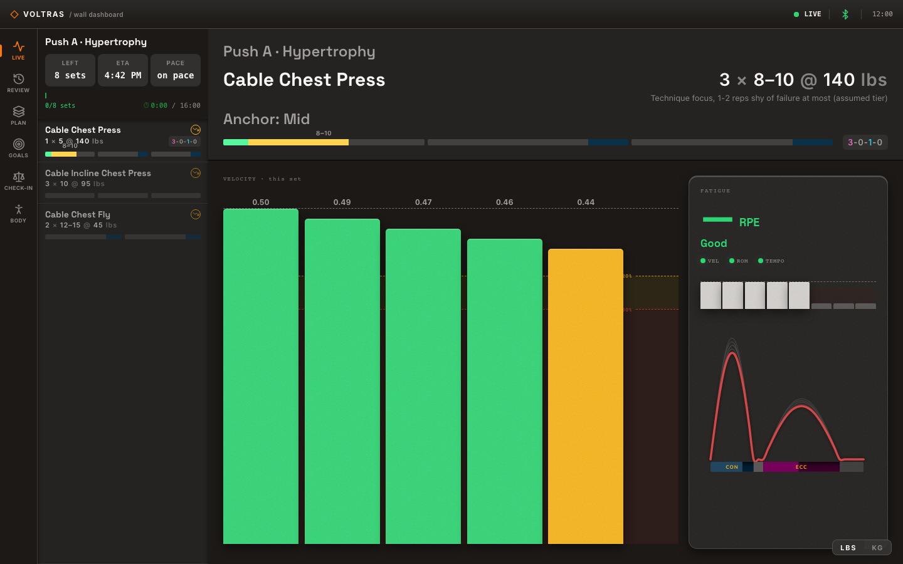

# voltras-mcp

Claude as a personal trainer on your Voltra. voltras-mcp is an MCP (Model Context Protocol)
server that lets Claude drive a Voltra digital-resistance trainer: connect to it, set the
load, record every set and rep, read the history back, and coach you through a workout out
loud. A local web dashboard shows the set as it happens.



**Docs: [hjewkes.github.io/voltras-mcp](https://hjewkes.github.io/voltras-mcp/)**, covering
setup, guides, the dashboard, coaching concepts, and the full capability reference.

## Requirements

- **Node 22.13.0 or later.** The store uses `node:sqlite`, which older releases do not
  load without a flag. Check with `node --version`.
- **Claude Code** as the MCP client.
- **For a real Voltra (macOS):** Bluetooth permission for the app that launches the server,
  and the Xcode Command Line Tools (`xcode-select --install`) for the native Bluetooth
  module. [Install](https://hjewkes.github.io/voltras-mcp/start/install) explains both.
- **No Voltra?** Run with `VOLTRA_ADAPTER=mock` and skip the hardware items.

## Quickstart

The package is not published to npm; clone and build it.

```bash
git clone https://github.com/HJewkes/voltras-mcp.git
cd voltras-mcp
npm ci                   # whisper's build can take several minutes; it is optional
npm run build            # the server
npm run build:dashboard  # the web dashboard

claude mcp add voltras -- node "$PWD/dist/bin.js"
# or, without a device:
# claude mcp add voltras -e VOLTRA_ADAPTER=mock -- node "$PWD/dist/bin.js"
```

`npm ci` installs exactly what `package-lock.json` pins; `npm install` can rewrite that file.
The install also compiles whisper for voice input. That can take several minutes, and if it
fails the install still succeeds: voice input is optional.

Restart Claude Code and ask Claude to call `server.health` to confirm the connection. Then
wake the Voltra's screen (a sleeping unit doesn't show up in a scan) and say something
like _"Find my Voltra, set it to 60 pounds, and start a session for incline press."_

Open the dashboard at `http://127.0.0.1:7723/app`. If another session already holds that
port, the server picks a free one; `server.health` reports the URL in `dashboardUrl`.

> [!WARNING]
> **The Voltra's own controls are your stop.** Voice stop is a convenience, off unless you turn
> it on, and while anything is being spoken it hears only safety phrases and can miss a "stop"
> that echoes the spoken line.
> [Details](https://hjewkes.github.io/voltras-mcp/concepts/how-coaching-works#the-spoken-stop-and-its-blind-spot).

## Where to go next

- [Your first session](https://hjewkes.github.io/voltras-mcp/start/first-session) and
  [trying it without a device](https://hjewkes.github.io/voltras-mcp/start/try-without-a-device)
- [Launch options](https://hjewkes.github.io/voltras-mcp/start/launch-options): the
  `voltra-pt` launcher (push events and a personal-trainer prompt), `.launch.env`, and running more
  than one session
- [The dashboard](https://hjewkes.github.io/voltras-mcp/guides/dashboard) and
  [troubleshooting](https://hjewkes.github.io/voltras-mcp/guides/troubleshooting), including
  backing up your training store
- [Capability reference](https://hjewkes.github.io/voltras-mcp/reference/): every tool,
  resource, push event and
  [environment variable](https://hjewkes.github.io/voltras-mcp/reference/environment-variables)
- [For coaches](https://hjewkes.github.io/voltras-mcp/coaches/): session reports and the
  weekly report
- [What changed](CHANGELOG.md)

**TrueCoach.** An optional, read-only import and a separate write-back tool exist. TrueCoach
publishes no developer API and its terms forbid unapproved third-party apps; read the
[TrueCoach guide](https://hjewkes.github.io/voltras-mcp/guides/truecoach) and its
terms-of-service section before using either.

## Development

```bash
npm test && npm run lint && npm run typecheck && npm run build
```

CI gates on lint, typecheck, test and build. Repo conventions live in `CLAUDE.md`; the
dashboard's architecture is in `src/dashboard/README.md`. Before reading the device tools,
see [docs/vocabulary.md](docs/vocabulary.md): "load" means at least three different things.

## Confidentiality

Beyond Power shared some device details informally to help the community SDK and asked that
they stay private. No protocol bytes, raw frame payloads or device command codes belong in
this repo's code, logs, schemas, docs or commits; the everyday tools pass Claude only typed
values such as weights, speeds and counts. Two diagnostic tools for hardware debugging are
the exception: `device.send_raw` takes and returns raw bytes, and `debug.recent_events` can
return them. An ESLint rule enforces part of this.
